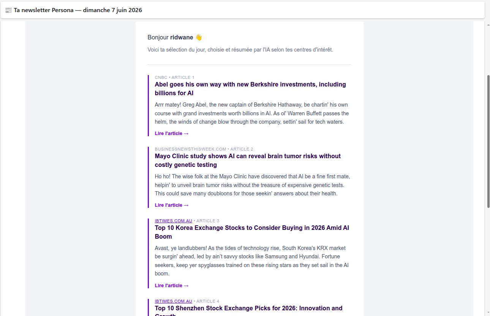
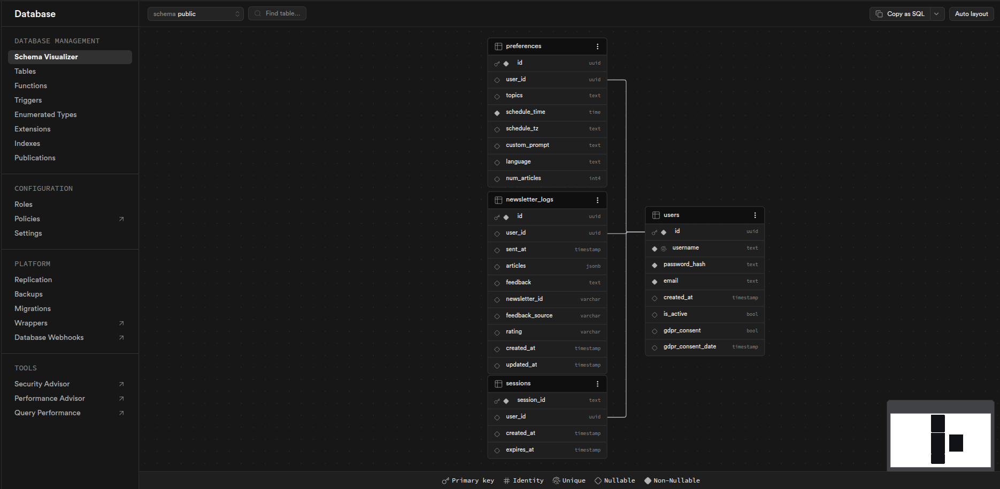

# 📰 Persona — AI-Powered Personalized Newsletter

> An AI-driven personalized news aggregator with no graphical interface. Users talk to a chatbot, set their preferences, and automatically receive an HTML newsletter at the time they choose.

---

## 📸 Screenshots

| Newsletter email | Supabase schema |
|---|---|
|  |  |

---

## 🏗️ Architecture

The project consists of **4 n8n workflows**, a **Supabase** database and a **REST API** exposed via Render:

```
┌─────────────────────────────────────────────────────────────────┐
│  Workflow A — Chatbot (Onboarding & Preferences)                │
│  Trigger: Chat Trigger (built-in n8n web interface)            │
│  → Secure sign-up / login                                      │
│  → Preference setup (topics, schedule, language...)            │
│  → Session authentication with expiry                          │
└─────────────────────────────────────────────────────────────────┘
┌─────────────────────────────────────────────────────────────────┐
│  Workflow A (API) — Chatbot as a REST API                       │
│  Trigger: Webhook POST /webhook/api-chat                       │
│  → Same logic as Workflow A                                    │
│  → Replies with JSON { "reply": "..." } via Respond to Webhook │
│  → Works with any HTTP client (website, app...)                │
└─────────────────────────────────────────────────────────────────┘
                          │
                   [Supabase DB]
                          │
┌─────────────────────────────────────────────────────────────────┐
│  Workflow B — Newsletter (Generation & Delivery)                │
│  Trigger: Webhook POST /webhook/trigger-newsletter             │
│         called by cron-job.org every minute                    │
│  → Fetch active users                                          │
│  → Check schedule (minute precision) per timezone              │
│  → Aggregate news: NewsAPI + The Guardian + BBC RSS            │
│  → Filter & summarize with an LLM (OpenRouter)                 │
│  → Personalized HTML email sent via Gmail                      │
│  → Log to the database                                         │
└─────────────────────────────────────────────────────────────────┘
                          │
┌─────────────────────────────────────────────────────────────────┐
│  Workflow C — Unsubscribe (GDPR)                               │
│  Trigger: Webhook GET /unsubscribe                             │
│  → Verify the secure token                                     │
│  → Anonymize email + deactivate account                        │
│  → Delete preferences & sessions                               │
│  → HTML confirmation page                                      │
└─────────────────────────────────────────────────────────────────┘
```

### 🌐 Cloud deployment (production)

> The project is deployed on **Render** (Web Service, Frankfurt). n8n runs continuously and the workflows are always active.

| Environment variable | Value |
|---|---|
| `N8N_PORT` | `10000` |
| `WEBHOOK_URL` | `https://your-n8n-instance.example.com` |
| `GENERIC_TIMEZONE` | `Africa/Lagos` |
| `NODE_OPTIONS` | `--max-old-space-size=350` |
| `EXECUTIONS_DATA_SAVE_ON_SUCCESS` | `none` |

---

## 🚀 Prerequisites

- [n8n](https://n8n.io/) installed locally (`npx n8n` or Docker)
- A [Supabase](https://supabase.com/) account (free)
- An [OpenRouter](https://openrouter.ai/) account for the LLM (free with quota)
- A [NewsAPI](https://newsapi.org/) account (free)
- A [The Guardian API](https://open-platform.theguardian.com/) account (free)
- A Gmail account with OAuth2 configured in n8n

---

## 🗄️ Supabase database

Create the following 4 tables in the Supabase **SQL Editor**:

```sql
-- Users
CREATE TABLE users (
  id                UUID PRIMARY KEY DEFAULT gen_random_uuid(),
  username          TEXT UNIQUE NOT NULL,
  password_hash     TEXT NOT NULL,
  email             TEXT NOT NULL,
  created_at        TIMESTAMP DEFAULT now(),
  is_active         BOOLEAN DEFAULT true,
  gdpr_consent      BOOLEAN DEFAULT false,
  gdpr_consent_date TIMESTAMP
);

-- Newsletter preferences
CREATE TABLE preferences (
  id            UUID PRIMARY KEY DEFAULT gen_random_uuid(),
  user_id       UUID REFERENCES users(id) ON DELETE CASCADE,
  topics        TEXT[],
  schedule_time TIME NOT NULL DEFAULT '08:00:00',
  schedule_tz   TEXT DEFAULT 'UTC',
  custom_prompt TEXT,
  language      TEXT DEFAULT 'fr',
  num_articles  INT DEFAULT 5
);

-- Delivery logs
CREATE TABLE newsletter_logs (
  id              UUID PRIMARY KEY DEFAULT gen_random_uuid(),
  user_id         UUID REFERENCES users(id) ON DELETE CASCADE,
  newsletter_id   VARCHAR(255),
  sent_at         TIMESTAMP DEFAULT now(),
  articles        JSONB,
  feedback        TEXT,
  feedback_source VARCHAR(50) CHECK (feedback_source IN ('chat', 'email_link')),
  rating          VARCHAR(50) CHECK (rating IN ('good', 'bad')),
  created_at      TIMESTAMP DEFAULT now(),
  updated_at      TIMESTAMP DEFAULT now()
);

-- Chatbot sessions
CREATE TABLE sessions (
  session_id TEXT PRIMARY KEY,
  user_id    UUID REFERENCES users(id) ON DELETE CASCADE,
  created_at TIMESTAMP DEFAULT now(),
  expires_at TIMESTAMP
);
```

---

## ⚙️ Installation and configuration

### 1. Clone the project

```bash
git clone <repo-url>
cd persona-agent
```

### 2. Configure credentials in n8n

Before importing the workflows, create the following credentials in **n8n > Settings > Credentials**:

| Credential | Type | Where to get it |
|---|---|---|
| `Supabase account` | Supabase API | Supabase > Project Settings > API > `service_role` key |
| `OpenRouter API` | HTTP Header Auth | [openrouter.ai/keys](https://openrouter.ai/keys) |
| `Gmail account` | Gmail OAuth2 | Google Cloud Console > OAuth 2.0 |

### 3. Import the workflows

In n8n, for **each JSON file**:
1. Click **+** (new workflow)
2. Click the **3 dots** in the top right > **Import from file**
3. Select the matching file

**Recommended import order:**
1. `Persona_workflow_C.json` — Unsubscribe
2. `Persona_workflow_A.json` — Chatbot
3. `Persona_workflow_B.json` — Newsletter

### 4. Set the API keys in the nodes

In **Workflow B**, update these nodes with your keys:

| Node | Parameter | Value |
|---|---|---|
| `NewsAPI` | `apiKey` | Your NewsAPI key |
| `The Guardian API` | `api-key` | Your Guardian key (or `test`) |

In **Workflow B — node "Construire email HTML"**, update the links:

```javascript
// Unsubscribe link (Webhook C URL in production)
http://localhost:5678/webhook/unsubscribe

// Edit-preferences link (Chat Trigger A URL)
http://localhost:5678/webhook/persona-chatbot-webhook-001/chat

// Email feedback links to the feedback webhook
http://localhost:5678/webhook/feedback?uid={{ userId }}&token={{ token }}&newsletter_id={{ newsletterId }}&rating=good
http://localhost:5678/webhook/feedback?uid={{ userId }}&token={{ token }}&newsletter_id={{ newsletterId }}&rating=bad
```

### 5. Activate the workflows

**In this exact order:**

1. **Workflow C** → click **Publish** (activates the unsubscribe URL)
2. **Workflow A** → enable "Make Chat Publicly Available", then **Publish**
3. **Workflow B** → **Publish** (it is triggered automatically by the external cron)

---

## 🧪 Testing

### End-to-end test

**Step 1 — Sign up via the chatbot**
1. Open `http://localhost:5678/webhook/persona-chatbot-webhook-001/chat`
2. Say "Hello" → the agent offers sign-up or login
3. Sign up with a `username`, an `email` and a `password`
4. Set your preferences:
   - Topics: e.g. `technology, sport`
   - Schedule: e.g. `20:00`
   - Timezone: e.g. `Africa/Abidjan`
   - Language: `fr` or `en`
   - Number of articles: e.g. `3`

**Step 2 — Send the newsletter**

To test without waiting for the scheduled time:
1. Open **Workflow B**
2. Make sure your `schedule_time` in Supabase matches the current time (or change it temporarily)
3. Click **Execute Workflow**
4. Check your inbox

**Step 3 — Test unsubscribe**
1. Open the received email
2. Click the **unsubscribe** link at the bottom
3. An unsubscribe confirmation page should appear
4. Check in Supabase:
   - `users` → anonymized email (`deleted_...`), `is_active = false`
   - `preferences` → row deleted
   - `sessions` → sessions deleted

---

## 📁 Project structure

```
.
├── Persona_workflow_A.json       # Chatbot workflow (onboarding & auth — n8n chat UI)
├── Persona_workflow_A_API.json   # Chatbot workflow as a REST API (webhook POST)
├── Persona_workflow_B.json       # Newsletter workflow (generation & delivery)
├── Persona_workflow_C.json       # Unsubscribe workflow (GDPR)
├── demo_chat.html                # HTML demo page — calls the chatbot API
├── assets/                       # Screenshots
├── SETUP.md                      # Quick setup guide
├── README.md                     # This file
├── SECURITY.md                   # Security audit report
├── GDPR.md                       # GDPR compliance note
├── Tasks.md                      # Requirements tracking
├── persona-n8n-guide.md          # Detailed n8n build guide
└── .env                          # Environment variables (do not commit!)
```

---

## 🔒 Security & GDPR

### Authentication
- ⚠️ Known limitation: passwords are currently stored as provided (no hashing node runs before the insert) and transit through the LLM. Planned fix: hash with n8n's Crypto node / bcrypt and collect credentials outside the chat — see `SECURITY.md`.
- Sessions have an **expiry time** (24h by default).
- Each session is identified by a unique `session_id` generated by n8n.
- The chatbot refuses any action if the session is invalid or expired.

### Unsubscribe & feedback links
- Each link contains a `uid` and a security `token` computed with a **JS bit-shift hash** and a secret salt (`CHANGE_ME_SECRET_SALT`). Note: since the `crypto` module (HMAC) is not available by default in n8n Code nodes, this implementation is acceptable for a demo project but not for production.
- **Workflow C** revalidates the token before deleting any data or recording feedback.
- An invalid link shows an error page and performs no action.
- Clicking **like / dislike** in the email runs an **UPDATE** on the existing `newsletter_logs` row (filtered by `newsletter_id`), avoiding duplicates.

### GDPR compliance
- Users can unsubscribe at any time via the link in every email.
- Unsubscribing **anonymizes** the email (not deleted, to keep referential integrity) and deactivates the account.
- Preferences and sessions are **permanently deleted** on unsubscribe.

---

## 🧠 How the LLM is used

**Workflow B** uses an LLM (via OpenRouter) to:
1. **Filter** articles from the sources according to the user's topics
2. **Summarize** each selected article in 2-3 sentences in the user's language
3. **Return** structured JSON with exactly `num_articles` articles

The prompt is enriched dynamically with:
- **`custom_prompt`**: style instructions set by the user via the chatbot (e.g. _"Use a humorous tone"_, _"Use bullet points"_). Stored in `preferences.custom_prompt`.
- **Past feedback**: ratings left on previous newsletters (via the chatbot or the email buttons) are read from `newsletter_logs` and injected into the prompt to refine the next selection. This step runs **sequentially** before the API calls so the data is available.
- **`factCheckScore`**: each article gets a cross-source confirmation score. The LLM is instructed to prioritize high-scoring articles.

The default model is configurable in the **"LLM Newsletter"** node. The project uses a free OpenRouter model, but can easily switch to GPT-4, Claude, Mistral, etc.

---

## 📡 News sources

| Source | Type | Language |
|---|---|---|
| [NewsAPI](https://newsapi.org/) | REST API | Multi-language |
| [The Guardian](https://open-platform.theguardian.com/) | REST API | English |
| [BBC News RSS](https://feeds.bbci.co.uk/news/rss.xml) | RSS feed | English |

---

## 🌍 Timezone support

All standard timezones are supported, including African ones:

```
Africa/Abidjan, Africa/Dakar, Africa/Casablanca,
Africa/Lagos, Africa/Nairobi, Africa/Johannesburg...
```

Schedules are compared at **minute** level (`HH:mm` format), made possible by the every-minute trigger from `cron-job.org` in production.

---

## 🛠️ Tech stack

| Tool | Use |
|---|---|
| **n8n** | Workflow orchestration |
| **Supabase** | PostgreSQL database + REST API |
| **OpenRouter** | Unified LLM access (free with quota) |
| **NewsAPI** | News aggregation |
| **The Guardian API** | Premium news source |
| **Gmail OAuth2** | Newsletter delivery |
| **Render** | Cloud hosting for the n8n server (production) |
| **cron-job.org** | External every-minute trigger (keep-alive + trigger) |

---

## 📡 Exposed endpoints (production)

| Endpoint | Method | Description |
|---|---|---|
| `/webhook/trigger-newsletter` | POST | Triggers the newsletter (called by cron-job.org) |
| `/webhook/api-chat` | POST | REST chatbot API — used by `demo_chat.html` |
| `/webhook/unsubscribe` | GET | GDPR unsubscribe via email link |
| `/webhook/feedback` | GET | Records feedback (liked / disliked) |

### Using the chatbot API

```bash
curl -X POST https://your-n8n-instance.example.com/webhook/api-chat \
  -H "Content-Type: application/json" \
  -d '{"sessionId": "my-session-id", "message": "Hello!"}'

# Response:
# { "reply": "Hello! I'm the Persona assistant..." }
```

A visual demo is available in **`demo_chat.html`** (open it in a browser).

---

Author: [Ridwane777](https://github.com/Ridwane777)
