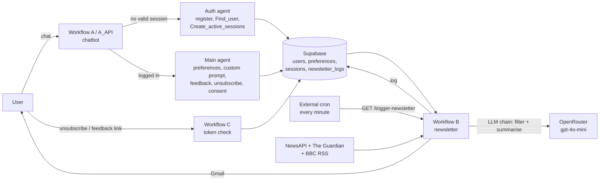

# Persona

Personalised news newsletter built with n8n. Users sign up and set their preferences by talking to a chatbot;
at the time they chose, they receive an HTML email with articles selected and summarised by an LLM from
NewsAPI, The Guardian and BBC News.

There is no web app: the product is four n8n workflows, a Supabase database and an optional demo chat page.

| Newsletter email | Supabase schema |
| --- | --- |
|  |  |

## Architecture



Workflow B, per user: load active users, check whether the current `HH:MM` matches the user's delivery time,
fetch the three sources, merge, normalise, deduplicate, compute a cross-source `factCheckScore`, add the user's
past feedback, ask the LLM to pick and summarise `num_articles` articles, parse the JSON (falling back to the
raw articles if parsing fails), build the HTML email, send it with Gmail and log it.

| Workflow | File | Trigger | Purpose | Output |
| --- | --- | --- | --- | --- |
| A | `workflows/a-chatbot.json` | n8n Chat Trigger (hosted chat page) | Sign-up, login, preferences, feedback, unsubscribe | Chat reply |
| A_API | `workflows/a-chatbot-api.json` | `POST /webhook/api-chat` | Same logic as A for any HTTP client (used by `demo/chat.html`) | JSON `{"reply": "..."}` |
| B | `workflows/b-newsletter.json` | `GET /webhook/trigger-newsletter`, called every minute by an external cron | Build and send the newsletters due now | Gmail email + `newsletter_logs` row |
| C | `workflows/c-unsubscribe-feedback.json` | `GET /webhook/unsubscribe`, `GET /webhook/feedback` | Verify the link token, then anonymise the account or store the rating | HTML confirmation page |

## Quickstart

1. Create the Supabase tables, the n8n credentials, then import the four JSON files.
2. Replace the placeholders (`YOUR_NEWSAPI_KEY`, `CHANGE_ME_SECRET_SALT`, the `localhost` links).
3. Activate C, A (and/or A_API), then B, and point an external cron at `/webhook/trigger-newsletter`.

Every step, the SQL and an end-to-end test are in [docs/setup.md](docs/setup.md).

## Concepts

Short version; the full explanations with references are in [docs/concepts.md](docs/concepts.md).

- **LLM agent with tools**: the chatbot is an n8n AI Agent node. The model decides, turn by turn, whether to
  answer or call a tool (here, Supabase operations) and reads the tool result before answering.
- **`$fromAI` tool arguments**: a tool field such as `$fromAI('email', 'The user\'s email address', 'string')` is
  filled by the model when it calls the tool. Convenient, but whatever the model writes goes to the database.
- **Window buffer memory**: each agent keeps the last N exchanges of the session (20 for auth, 30 for main) so
  the conversation has context.
- **Two-agent split**: a deterministic `If` on the session picks either the auth agent (only sign-up and login
  tools) or the main agent (only account tools). A logged-out user cannot reach the account tools.
- **LLM chain vs agent**: Workflow B uses a basic LLM chain (one prompt in, one answer out, no tools) because the
  steps are fixed; agents are kept for the open-ended chat.
- **Cross-source fact-check heuristic**: `factCheckScore` counts articles from *other* sources whose headline
  shares one of the first three long words of this headline. It measures coverage, not truth.
- **No RAG**: there is no vector store or embedding search. Articles are fetched live and placed in the prompt.

## Security and privacy

- Passwords are stored as **unsalted SHA-256** (`$fromAI('password', ...).hash('sha256')`). This is fast to
  attack if the table leaks, and the plaintext password transits through the LLM provider because it is typed
  in the chat. Fix: login outside the chat (Supabase Auth or a form) and bcrypt/argon2.
- Unsubscribe and feedback links use a **demo-grade** bit-shift hash with a static salt; HMAC-SHA256 is the fix.
- Several tool arguments, including `user_id`, are chosen by the model; binding them to the session is planned.
- Unsubscribe anonymises the email and deactivates the account; it is pseudonymisation, not full erasure.

Details: [docs/security.md](docs/security.md) and [docs/legal/gdpr.md](docs/legal/gdpr.md).

## Models

The LLM nodes use `openai/gpt-4o-mini` through OpenRouter. Any chat model available on OpenRouter can be
selected in the `LLM Auth`, `LLM Main` and `LLM Newsletter` nodes; tool calling must be supported for the two
agent nodes. Cost estimate: [docs/costs.md](docs/costs.md).

## Documentation

| Document | Content |
| --- | --- |
| [docs/setup.md](docs/setup.md) | Installation, configuration, test |
| [docs/concepts.md](docs/concepts.md) | Agents, tools, memory, LLM chain, fact-check heuristic |
| [docs/adr/](docs/adr/README.md) | Architecture decision records |
| [docs/dependencies.md](docs/dependencies.md) | External services, quotas, credentials, licences |
| [docs/costs.md](docs/costs.md) | Estimated running costs |
| [docs/security.md](docs/security.md) | Security review and fixes |
| [docs/legal/gdpr.md](docs/legal/gdpr.md) | Personal data and GDPR |
| [docs/retrospective.md](docs/retrospective.md) | What to do differently |
| [docs/build-guide.md](docs/build-guide.md) | Original step-by-step build guide |

Map of all documents: [docs/README.md](docs/README.md).

## Project structure

```
.
├── workflows/
│   ├── a-chatbot.json               # Workflow A: chatbot on the n8n hosted chat
│   ├── a-chatbot-api.json           # Workflow A_API: same chatbot as a REST endpoint
│   ├── b-newsletter.json            # Workflow B: newsletter generation and delivery
│   └── c-unsubscribe-feedback.json  # Workflow C: unsubscribe and feedback links
├── demo/
│   └── chat.html                    # Landing page that calls the A_API endpoint
├── assets/                          # Screenshots (email, database)
├── docs/
│   ├── README.md                    # Documentation map
│   ├── setup.md                     # Installation (single source)
│   ├── concepts.md
│   ├── dependencies.md
│   ├── costs.md
│   ├── security.md
│   ├── retrospective.md
│   ├── build-guide.md
│   ├── legal/gdpr.md
│   └── adr/                         # Decision records 0001 to 0006
├── LICENSE
└── README.md
```

## Author

[Ridwane777](https://github.com/Ridwane777)

## License

MIT, see [LICENSE](LICENSE).
